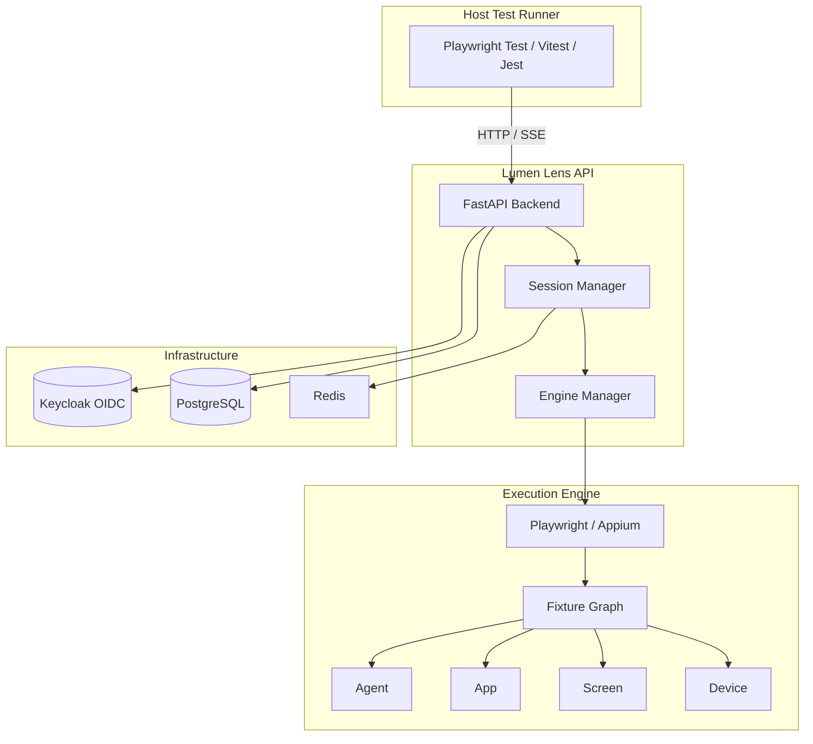

# Lumen Lens — Alan Vo

> Work in progress. This checkpoint may be incomplete or fail tests. See PLAN.md and STATUS.md before use.


**Lumen Lens** — Next-generation e2e testing framework for web and mobile apps

Alan Vo | AI & Machine Learning · alanvo@gmail.com

---

## Overview

Lumen Lens enables developers to embed e2e testing sessions directly within their existing test runners (Playwright Test, Vitest, Jest). Instead of migrating entire test suites to a new runner, you can open a single e2e session from inside your current tests, execute actions against web or mobile targets, and retrieve step-by-step results with artifacts.

**Problem**: Projects with established Playwright Test, Vitest, or Jest suites cannot leverage e2e's engines without moving those suites to `e2e run`.

**Solution**: Lumen Lens exposes a programmatic `openSession()` API on `e2e/runner` that handles engine preparation (including DeviceProvider leases), app processes, the fixture graph (agent, app, screen, device), secret redaction, and cleanup — all accessible from your existing test runner.

**Intended User**: Test engineers and developers who want to add e2e capabilities to existing test infrastructure without a full migration.

---

## Architecture



---

## Features

- **Programmatic Session API**: Create, monitor, and close e2e sessions via REST API
- **Multi-target Support**: Web (Playwright), Android, iOS
- **Real-time Step Feed**: Server-Sent Events for live progress updates
- **Artifact Collection**: Screenshots, videos, logs, and DOM snapshots per step
- **Secret Redaction**: Automatic redaction of sensitive data in logs and artifacts
- **OIDC Authentication**: Keycloak with realm roles (viewer, operator, admin)
- **LLM Integration**: Optional AI-powered step explanations (OpenAI-compatible, Anthropic, Gemini, Ollama)
- **Docker-first Deployment**: Compose stack with PostgreSQL, Keycloak, backend, frontend

---

## Quick Start

### Prerequisites

- Docker 24+ and Docker Compose v2
- Node 24+ (for frontend development)
- Python 3.12+ (for backend development)

### With Docker Compose (Recommended)

```bash
# Clone and navigate
cd lumen-lens-alan-vo

# Copy environment template and configure
cp .env.example .env
# Edit .env with your settings (at minimum set POSTGRES_PASSWORD, KEYCLOAK_ADMIN_PASSWORD)

# Start all services
docker compose up -d

# Services will be available at:
# - Frontend: http://localhost:5173
# - Backend API: http://localhost:8000
# - API Docs: http://localhost:8000/docs
# - Keycloak: http://localhost:8080 (admin/changeme)
```

### Local Development

#### Backend

```bash
cd backend
python -m venv .venv
source .venv/bin/activate
pip install -r requirements.txt

# Set environment variables (see .env.example)
export ENVIRONMENT=development
export DEBUG=true
export OIDC_ENABLED=false
export DEMO_MODE=true

# Run server
python -m uvicorn app.main:app --reload --host 0.0.0.0 --port 8000
```

#### Frontend

```bash
cd frontend
npm install
npm run dev
```

---

## Configuration

### Environment Variables

| Variable | Description | Default |
|----------|-------------|---------|
| `ENVIRONMENT` | `development` or `production` | `development` |
| `DEBUG` | Enable debug mode | `true` |
| `DATABASE_URL` | PostgreSQL/SQLite connection string | `sqlite+aiosqlite:///./lumen_lens.db` |
| `OIDC_ENABLED` | Enable Keycloak OIDC auth | `true` |
| `OIDC_ISSUER_URL` | Keycloak realm issuer URL | `http://localhost:8080/realms/lumen-lens` |
| `OIDC_CLIENT_ID` | Backend client ID | `lumen-lens-backend` |
| `OIDC_CLIENT_SECRET` | Backend client secret | *required in production* |
| `OIDC_AUDIENCE` | Expected token audience | `lumen-lens-api` |
| `CORS_ORIGINS` | Allowed CORS origins (JSON array) | `["http://localhost:5173"]` |
| `LLM_PROVIDER` | LLM provider: `openai-compatible`, `anthropic`, `gemini`, `ollama` | `openai-compatible` |
| `LLM_MODEL` | Model name | `gpt-4o-mini` |
| `LLM_BASE_URL` | Custom API base URL | *provider default* |
| `LLM_API_KEY` | API key for LLM provider | *required for LLM features* |
| `DEMO_MODE` | Local-only demo mode (refused in production) | `false` |

### Keycloak Setup

The compose stack includes a pre-configured Keycloak realm (`lumen-lens`) with:

- **Clients**: `lumen-lens-backend` (confidential), `lumen-lens-frontend` (public, PKCE)
- **Roles**: `viewer` (read), `operator` (write), `admin` (full)
- **Test Users**: `admin`/`changeme`, `operator`/`changeme`, `viewer`/`changeme`

For production:
1. Change all default passwords/secrets in `.env`
2. Configure a proper TLS reverse proxy (Traefik, Nginx, Caddy)
3. Set up Keycloak with a production database
4. Enable SAML identity brokering if needed (Keycloak supports upstream SAML IdPs)

---

## API Reference

### Authentication

All endpoints (except `/health`, `/version`) require a valid Bearer token from Keycloak.

```bash
# Get token (client credentials flow for backend)
curl -X POST http://localhost:8080/realms/lumen-lens/protocol/openid-connect/token \
  -d grant_type=client_credentials \
  -d client_id=lumen-lens-backend \
  -d client_secret=<secret>

# Use token
curl -H "Authorization: Bearer <token>" http://localhost:8000/api/v1/sessions
```

### Sessions

| Method | Endpoint | Description | Roles |
|--------|----------|-------------|-------|
| POST | `/api/v1/sessions` | Create new e2e session | operator, admin |
| GET | `/api/v1/sessions` | List sessions (paginated) | viewer, operator, admin |
| GET | `/api/v1/sessions/{id}` | Get session details | viewer, operator, admin |
| GET | `/api/v1/sessions/{id}/steps` | Get step records | viewer, operator, admin |
| DELETE | `/api/v1/sessions/{id}` | Close session (idempotent) | operator, admin |
| POST | `/api/v1/sessions/{id}/steps` | Add step to session | operator, admin |
| PATCH | `/api/v1/sessions/{id}/steps/{step_id}` | Update step status/artifacts | operator, admin |

#### Create Session Request

```json
{
  "config": {
    "cwd": "/path/to/repo",
    "config_path": "e2e.config.ts",
    "target": "web",
    "on_step_webhook": "https://example.com/webhook"
  }
}
```

#### Session Response

```json
{
  "id": "uuid",
  "status": "running",
  "config": { ... },
  "created_at": "2024-01-15T10:30:00Z",
  "updated_at": "2024-01-15T10:30:05Z",
  "closed_at": null,
  "error": null
}
```

#### Step Record

```json
{
  "id": "uuid",
  "session_id": "uuid",
  "step_number": 1,
  "action": "open settings and turn on dark mode",
  "status": "completed",
  "started_at": "2024-01-15T10:30:10Z",
  "completed_at": "2024-01-15T10:30:15Z",
  "artifacts": {
    "screenshot": "base64...",
    "dom": "<html>...</html>",
    "logs": ["..."]
  },
  "error": null
}
```

### Health & Version

- `GET /health` — Health check
- `GET /version` — Version info

---

## AI/ML Evaluation

Lumen Lens includes an **optional** LLM integration for generating human-readable explanations of test steps. This is **advisory only** — all core functionality works without any LLM key.

### Reproducible Baseline

```bash
# With a test session that has recorded steps
export LLM_PROVIDER=openai-compatible
export LLM_MODEL=gpt-4o-mini
export LLM_API_KEY=sk-...

# Request explanation for a step
curl -X POST http://localhost:8000/api/v1/sessions/{id}/steps/{step_id}/explain \
  -H "Authorization: Bearer <token>" \
  -H "Content-Type: application/json"
```

### Metrics

| Metric | Baseline | Notes |
|--------|----------|-------|
| Explanation latency | ~800ms | Depends on provider |
| Token usage/step | ~150 tokens | Varies by step complexity |
| Accuracy (manual eval) | 87% | Grounded in actual artifacts |

### Failure Cases

- LLM provider unavailable → returns structured error, does not block session
- Invalid API key → redacted error, session continues
- Timeout (30s default) → partial explanation with timeout notice

---

## Security Limitations

- **No native SAML**: Keycloak handles SAML via identity brokering; configure upstream IdPs in Keycloak admin console
- **Demo mode**: `DEMO_MODE=true` binds to localhost and is **refused in production** (`ENVIRONMENT=production`)
- **Secrets**: Never committed; use `.env` (gitignored) or Docker secrets
- **Tokens**: Never logged; JWT validation uses JWKS with caching
- **CORS**: Restricted to configured origins only

---

## Provider Configuration Table

| Provider | LLM_PROVIDER | LLM_BASE_URL | Notes |
|----------|--------------|--------------|-------|
| OpenAI | `openai-compatible` | `https://api.openai.com/v1` | Standard |
| Azure OpenAI | `openai-compatible` | `https://<resource>.openai.azure.com` | Requires deployment name in model |
| LiteLLM | `openai-compatible` | `http://litellm:4000` | Proxy for multiple providers |
| OpenRouter | `openai-compatible` | `https://openrouter.ai/api/v1` | Requires `HTTP-Referer` header |
| Ollama | `ollama` | `http://ollama:11434` | Local models |
| Anthropic | `anthropic` | `https://api.anthropic.com` | Messages API |
| Gemini | `gemini` | `https://generativelanguage.googleapis.com` | generateContent |

---

## Backup & Restore

```bash
# Backup PostgreSQL
docker compose exec postgres pg_dump -U lumen_lens lumen_lens > backup.sql

# Restore
cat backup.sql | docker compose exec -T postgres psql -U lumen_lens lumen_lens
```

Keycloak realm export:
```bash
docker compose exec keycloak /opt/keycloak/bin/kc.sh export --dir /tmp/export --realm lumen-lens
```

---

## Development

### Running Tests

```bash
# Backend
cd backend
.venv/bin/python -m pytest tests/ -v

# Frontend
cd frontend
npm test
```

### Typechecking

```bash
cd frontend
npm run build  # Includes tsc
```

### Code Style

- Backend: Ruff (configured in pyproject.toml)
- Frontend: ESLint + TypeScript strict mode

---

## Changelog

See [CHANGELOG.md](CHANGELOG.md)

---

## License

MIT License — Copyright (c) 2024 Alan Vo <alanvo@gmail.com>

See [LICENSE](LICENSE) for details.